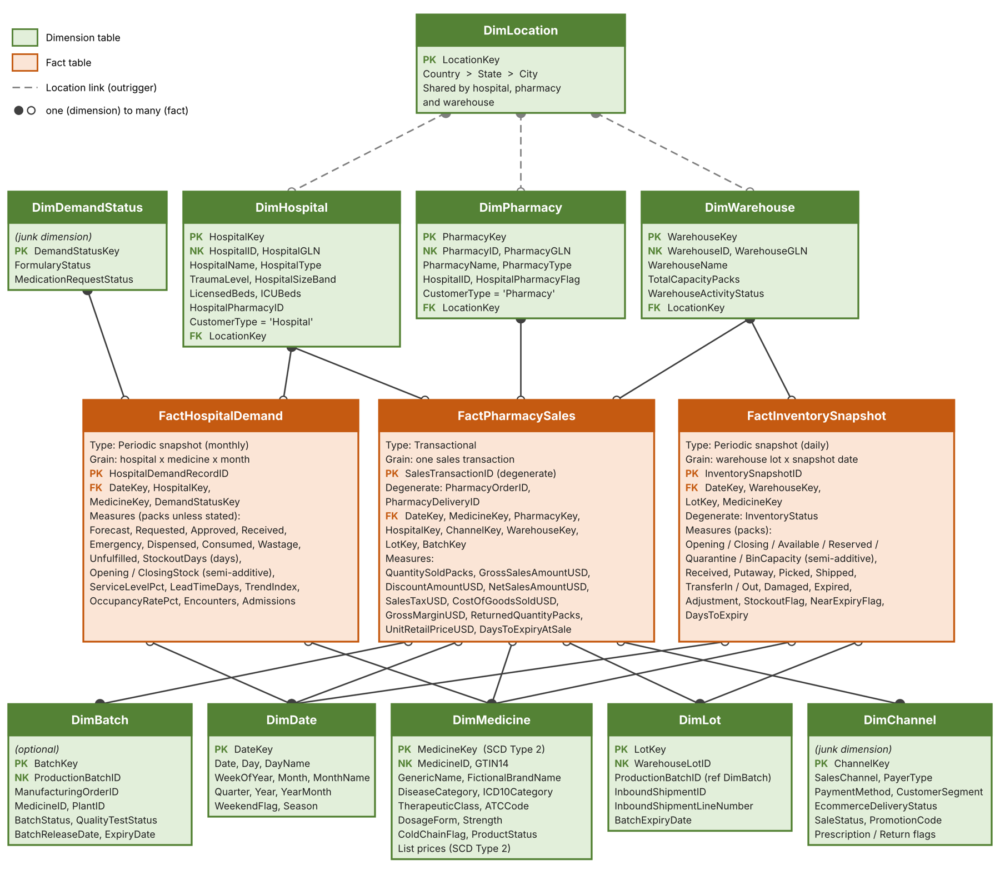

# Pharma Supply Chain — Sales & Demand Intelligence (SDI) Data Mart

Data warehouse course project. Domain: **pharmaceutical supply chain**. Business process: **sales and demand analysis**
(pharmacy sales vs. hospital demand vs. warehouse inventory).

| Milestone | Deliverable | Where |
|---|---|---|
| **Milestone 1 — SDI data mart** | Completed DWH design workbook | [`milestone_1/excel/DWH_Template_Milestone1_SDI_DataMart.xlsx`](milestone_1/excel/DWH_Template_Milestone1_SDI_DataMart.xlsx) |
| | Airflow pipeline up to the query layer | [`dags/pharma_sdi_data_mart_dag.py`](dags/pharma_sdi_data_mart_dag.py) + [`sql/`](sql) 
Start with **[`milestone_1/README.md`](milestone_1/README.md)**: it maps every requirement to a file.

---

## Architecture

```
 data/raw/*.csv.gz  (7 OLTP extracts, 934,448 rows)
        │  extract_raw        copy as text into schema raw (no type guessing, GTIN leading zeros kept)
        ▼
   raw.*  ──► staging         clean + type (Transform.OLTP sheet) ──► 25 data-quality checks
        ▼
   stg.*  ──► dimensions      10 dimensions, persistent surrogate keys, -1 "Unknown" members,
        │                     SCD Type 2 on medicine prices, SCD Type 1 elsewhere, 2 junk dimensions
        ▼
   dwh.*  ──► facts           FactPharmacySales (transaction), FactHospitalDemand (monthly snapshot),
        │                     FactInventorySnapshot (daily snapshot) ──► 18 reconciliation / FK checks
        ▼
  mart.*  ──► query layer     q1, q2, q3 (the 3 dimensional queries), kpi_monthly, what_if_base,
        │                     kpi_confidence_intervals (bootstrap), optional oversampling (sandbox.*)
        ▼


Warehouse engine: **DuckDB** (one file, `warehouse/pharma_sdi.duckdb`, ≈100 MB, rebuilt by the DAG).
Orchestration: **Apache Airflow 2.10.5**. A full run takes about 1.5 minutes.



## Run it

### Option A — Docker (Windows, macOS, Linux)

```bash
git clone <this repo> && cd pharma-sdi-data-mart
# Linux only: echo "AIRFLOW_UID=$(id -u)" > .env
docker compose up --build
```

1. Open <http://localhost:8080> and log in with `admin` / `admin`.
2. Turn on the DAG **`pharma_sdi_data_mart`**. It runs once straight away; or press ▶ *Trigger DAG*.
3. When every task is green, open `dashboard/index.html` in a browser, or query the warehouse:
   `python scripts/query.py q1` (shortcuts: `q1 q2 q3 kpi whatif ci dq`).

### Option B — without Docker (Linux / macOS / WSL, Python 3.12)

```bash
bash scripts/run_local.sh        # installs Airflow 2.10.5 in .venv and runs the whole DAG once
bash scripts/run_local.sh 2      # same, plus a 2x oversampled sales table in the sandbox schema
```

### Test

```bash
python tests/test_scd2_dim_medicine.py   # proves SCD Type 2 history on DimMedicine
```

## DAG parameters

| Param | Default | What it does |
|---|---|---|
| `oversample_factor` | `1` (off) | `> 1` writes `sandbox.fact_pharmacy_sales_oversampled`, a bootstrap-resampled copy of the sales fact that is *factor* times larger. The real facts are never touched. |
| `bootstrap_replicates` | `200` | Number of resamples behind the 95 % confidence intervals in `mart.kpi_confidence_intervals`. |
| `seed` | `0.42` | Random seed (DuckDB `setseed`, between 0 and 1). |

Trigger with parameters from the UI (*Trigger DAG w/ config*) or `airflow dags trigger pharma_sdi_data_mart -c '{"oversample_factor": 2}'`.

### Oversampling and resampling: what they do and do not do

**Formal.** Oversampling draws *n · k* rows with replacement from the *n* sales transactions (bootstrap oversampling).
Each KPI's *expected* value is unchanged for ratios (margin %, shares, averages), and multiplied by *k* for sums
(revenue, packs). The confidence intervals instead use a **Poisson bootstrap**: each transaction gets weight
*w ~ Poisson(1)* in each of *B* replicates, and the 95 % interval is the 2.5th–97.5th percentile of the *B* recomputed KPIs.

**In plain words.** Copying rows at random does not add information. The new rows are repeats of sales we already
have, so totals just grow (2× rows = 2× revenue) and percentages stay the same. That is why the oversampled table
lives in its own `sandbox` schema and the dashboard reads the real facts. The step that *does* make results more trustworthy is resampling to
measure precision: re-draw the sales many times and see how much each figure moves. For this dataset, yearly net sales per
disease category move by only about ±1–2 %, and gross margin by about ±0.05 percentage points.
`sandbox.v_oversample_check` shows the disease mix is preserved after oversampling.

## Repository map

```
dags/pharma_sdi_data_mart_dag.py   Airflow DAG (30 tasks in 5 task groups)
etl/                               Python helpers: config, DuckDB runner + DQ engine, exporter
sql/00_setup                       schemas, audit tables, cleaning macros
sql/02_staging                     raw -> stg (cleaning and typing)
sql/03_dimensions                  10 dimensions (SCD1 / SCD2 / junk / generated date)
sql/04_facts                       3 fact tables
sql/05_query_layer                 mart views: q1-q3, KPIs, what-if
sql/06_quality                     data-quality checks (staging and star schema)
sql/07_oversampling                bootstrap confidence intervals + optional oversampling
data/raw/                          the 7 source files (.csv.gz, read directly by DuckDB)
exports/                           query-layer outputs as CSV (from the last run)
dashboard/                         template.html + index.html (demo page) + data.json
milestone_1/                       Excel workbook, docs, EDA, demo script, screenshots
scripts/                           run_local.sh, query.py
tests/                             SCD2 test
```
